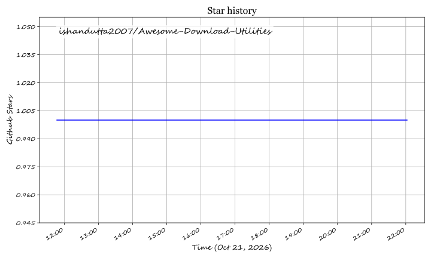

<div align="center">



# ⚡ Awesome Download Utilities 🚀

**A curated index of top SaaS platforms, commercial accelerators, and open-source file download engines.**

<p align="center">
  <a href="https://github.com/ishandutta2007/Awesome-Awesome-Awesome"></a><a href="https://discord.gg/jc4xtF58Ve"></a>
  <a href="https://github.com/ishandutta2007/Awesome-Download-Utilities/stargazers"></a>
  <a href="https://github.com/ishandutta2007/Awesome-Download-Utilities/network/members"></a>
  <a href="LICENSE"></a>
  <a href="https://github.com/ishandutta2007/Awesome-Download-Utilities/pulls"></a>
  <a href="https://github.com/ishandutta2007"></a>
</p>

*Master list of download accelerators, multi-segment transfer managers, batch downloaders, CLI automation tools, and browser integration extensions. Updated regularly for 2026.*

</div>

---

## 📖 Table of Contents

- [🔍 Overview & SEO Highlights](#-overview--seo-highlights)
- [📊 Sector Overview & Market Dynamics](#-sector-overview--market-dynamics)
- [💼 SaaS & Commercial Download Platforms](#-saas--commercial-download-platforms)
- [🔓 Open-Source GitHub Projects](#-open-source-github-projects)
- [🏗️ Architectural Frameworks & Synergy](#️-architectural-frameworks--synergy)
- [🤝 How to Contribute](#-how-to-contribute)
- [💖 Support & Sponsorship](#-support--sponsorship)
- [⚖️ Disclaimer](#️-disclaimer)
- [⭐ Star History](#-star-history)

---

## 🔍 Overview & SEO Highlights

Whether you are fetching massive 100GB+ datasets, managing high-concurrency scraping queues, downloading 4K/8K video media streams, or recovering from interrupted connections on high-latency networks, **Download Utilities** are foundational to modern computing infrastructure.

This repository catalogs both **enterprise-grade SaaS/commercial utilities** and **high-performance open-source GitHub downloaders**. Key capabilities evaluated across this collection include:
- **Dynamic Multi-Connection File Segmentation (MGET / Chunking)**: Squeezing maximum throughput from gigabit connections by splitting single files across up to 64 concurrent socket streams.
- **Resilient Resume & Integrity Checksums**: Byte-level resumption over HTTP `Range` headers, BitTorrent piece validation, and automated SHA-256/MD5 hash verification.
- **Universal Protocol Support**: HTTP, HTTPS, FTP, SFTP, BitTorrent, Magnet URIs, Metalink, DASH, and HLS streams.
- **Deep Browser & Automation Integration**: Native messaging extensions for Chrome, Firefox, Safari, Edge, alongside REST, JSON-RPC, and headless CLI scripting hooks.

---

## 📊 Sector Overview & Market Dynamics

The global file acceleration, remote cloud downloading, and high-speed data transfer utilities market is estimated at **$1.8B – $2.4B USD**, propelled by exponential increases in video resolutions, cloud storage replication pipelines, and gaming patch payload sizes (frequently exceeding 50GB per release).

The sector is characterized by **moderate fragmentation rather than a winner-take-all monopoly**. While traditional commercial desktop accelerators (like Tonec's Internet Download Manager) retain entrenched enterprise and desktop market share, high-performance open-source CLI frameworks (like `aria2` and `yt-dlp`) and emerging SaaS cloud seedboxes (like `Put.io` and `Seedr`) prevent monopolistic capture, providing thriving niches for indie software developers, protocol innovators, and open-source contributors alike.

---

## 💼 SaaS & Commercial Download Platforms

The table below provides a comprehensive comparison of leading SaaS and commercial download acceleration platforms, sorted in descending order by estimated company scale and annual revenue.

| Product / Service | Company / Publisher | Est. Scale (Revenue / Valuation) | Pricing (Starting Tier) | Free Tier Limit | Primary Focus & Capabilities |
| :--- | :--- | :--- | :--- | :--- | :--- |
| **[Internet Download Manager (IDM)](https://www.internetdownloadmanager.com/)** | Tonec Inc. | ~$25M – $35M ARR / $100M+ Val. | $11.95 / year (1 PC license) or $24.95 lifetime | 30-day free trial (fully functional, 0 days free forever) | Flagship Windows accelerator with dynamic 32-stream segmentation, scheduler, and universal browser extension sniffer. |
| **[Folx PRO](https://www.mac-downloader.com/)** | Electronic Team, Inc. | ~$12M – $18M ARR / $50M Val. | $19.95 one-time (Personal license, 1 Mac) | Free forever (capped at 2 concurrent threads; no scheduling, no speed throttling, no video grabber) | Native macOS download manager and torrent client with Safari/Chrome integration and smart tag organization. |
| **[BitComet](https://www.bitcomet.com/)** | Comet Networks Co., Ltd. | ~$8M – $12M ARR / $30M Val. | $2.99 / month (VIP Comet Pass acceleration tier) | Free forever ad-supported (unlimited standard peer/HTTP tasks; VIP cloud seed cache disabled) | Hybrid P2P, HTTP, and FTP client featuring long-term seeding cache and intelligent disk cache buffering. |
| **[Put.io](https://put.io/)** | Enüstkat Information Tech | ~$6M – $10M ARR / $25M Val. | $9.99 / month (Basic Plan: 100 GB storage, 10 active slots) | 1-day free trial (10 GB cloud storage, 1 active download slot, no permanent free tier) | SaaS remote cloud downloader fetching web links, RSS, and torrents directly onto high-speed cloud drives. |
| **[JDownloader Cloud](https://jdownloader.org/)** | AppWork GmbH | ~$4M – $7M ARR / $18M Val. | €2.50 / month (~$2.70/mo My.JDownloader Supporter) | Free forever desktop app (unlimited hoster downloads; capped at 100 push notifications/day & manual captcha solving) | Java cross-platform downloader supporting 1,100+ hosters, automatic archive extraction, and remote cloud API control. |
| **[Seedr](https://www.seedr.cc/)** | Seedr Technologies Ltd. | ~$3M – $6M ARR / $12M Val. | $6.95 / month (Basic Plan: 30 GB storage, 2 parallel tasks) | Free forever plan (2 GB storage quota, 1 parallel download slot, standard bandwidth speed) | Browser-based cloud download manager enabling direct streaming and secure cloud-side torrent fetching. |
| **[Free Download Manager (FDM)](https://www.freedownloadmanager.org/)** | Softdeluxe Ltd. | ~$2M – $5M ARR / $10M Val. | $9.95 one-time (Pro sponsorship & commercial distribution) | Free forever for personal use (10 simultaneous connections, unthrottled, ad-free) | Modern cross-platform GUI manager (Win/macOS/Linux/Android) with BitTorrent, bandwidth scheduling, and browser integration. |
| **[Ninja Download Manager](https://ninjadownloadmanager.com/)** | Kuching Soft Ltd. | ~$800K – $1.5M ARR / $3M Val. | $19.00 one-time (1 PC lifetime license) | Free basic edition (capped at 3 simultaneous downloads; 20x multi-thread turbo acceleration disabled) | Sleek desktop accelerator with sequential video previewing, clipboard monitoring, and multi-connection acceleration. |
| **[EagleGet](https://www.eagleget.org/)** | EagleGet Inc. | ~$500K – $1.2M ARR / $2M Val. | $9.95 one-time (Ad-free VIP registration) | Free forever ad-supported (unlimited downloads, up to 32 connection streams, video grabber) | Windows multi-threaded download accelerator supporting HTTP, HTTPS, FTP, MMS, and RTSP protocols. |
| **[FlashGet](https://www.flashget.com/)** | Amaze Soft Ltd. | ~$300K – $800K ARR / $1.5M Val. | $14.95 lifetime (Legacy Pro / freeware model) | Free forever ad-supported (limited to 10 split segments per task and 8 simultaneous tasks) | Classic MGET multi-server hyper-threading transfer utility with built-in antivirus trigger integration. |

---

## 🔓 Open-Source GitHub Projects

The following curated open-source download utilities are sorted in descending order by GitHub Stars_Count. Each entry features a live Stars_Count badge linking directly to the project's stargazers page.

1. **[yt-dlp](https://github.com/yt-dlp/yt-dlp)** [](https://github.com/yt-dlp/yt-dlp/stargazers)  
   The gold standard command-line audio/video downloader supporting thousands of media platforms. Features multi-threaded chunk downloading, custom post-processing through `ffmpeg`, sponsorblock integration, and comprehensive metadata extraction.

2. **[Motrix](https://github.com/agalwood/Motrix)** [](https://github.com/agalwood/Motrix/stargazers)  
   A full-featured, cross-platform download manager built on Electron and powered by `aria2`. Offers a sleek, modern UI supporting HTTP, FTP, BitTorrent, and Magnet links with up to 64 concurrent download threads and automated tracker updates.

3. **[you-get](https://github.com/soimort/you-get)** [](https://github.com/soimort/you-get/stargazers)  
   A tiny command-line utility written in Python 3 to scrape and download media contents (videos, audios, images) from the Web when standard browser downloads fail.

4. **[aria2](https://github.com/aria2/aria2)** [](https://github.com/aria2/aria2/stargazers)  
   The foundational ultra-fast, multi-protocol, and multi-source command-line download utility. Supports HTTP/HTTPS, FTP, SFTP, BitTorrent, and Metalink. Features JSON-RPC and XML-RPC interfaces, chunked segmented downloading, and minimal memory footprint.

5. **[qBittorrent](https://github.com/qbittorrent/qBittorrent)** [](https://github.com/qbittorrent/qBittorrent/stargazers)  
   An open-source Qt-based BitTorrent client with integrated search engines, sequential downloading for media previews, bandwidth scheduler, advanced web remote control UI, and full IP filtering.

6. **[lux](https://github.com/iawia002/lux)** [](https://github.com/iawia002/lux/stargazers)  
   A blazingly fast and lightweight video download CLI library written in Go. Supports parallel stream downloads, automatic segment concatenation, and cookies handling for authenticated media sources.

7. **[gallery-dl](https://github.com/mikf/gallery-dl)** [](https://github.com/mikf/gallery-dl/stargazers)  
   An advanced CLI program designed to batch download image galleries, collections, and manga archives from hundreds of image hosting platforms, featuring customizable folder naming schemes and tagging.

8. **[ab-download-manager](https://github.com/amir1376/ab-download-manager)** [](https://github.com/amir1376/ab-download-manager/stargazers)  
   A modern desktop download manager and speed accelerator written with Kotlin and Compose Multiplatform. Features browser extensions for Chrome and Firefox, dynamic multi-connection splitting, download queuing, and speed limiters.

9. **[Transmission](https://github.com/transmission/transmission)** [](https://github.com/transmission/transmission/stargazers)  
   A fast, lightweight, and hardware-efficient cross-platform BitTorrent client. Features native macOS, GTK, and Qt frontends alongside a headless daemon with web client and JSON-RPC API for headless servers and NAS setups.

10. **[File Centipede](https://github.com/filecxx/FileCentipede)** [](https://github.com/filecxx/FileCentipede/stargazers)  
    An all-in-one internet upload and download manager supporting HTTP(S), FTP(S), SSH, Magnet, BitTorrent, m3u8 streams, and WebDAV with customizable JavaScript scripting rules and browser extensions.

11. **[Xtreme Download Manager (XDM)](https://github.com/subhra74/xdm)** [](https://github.com/subhra74/xdm/stargazers)  
    A powerful download accelerator claiming up to 500% speed increase. Supports video capture from streaming sites, seamless browser integration (Chrome, Firefox, Edge, Brave), download resumption, and scheduled queue execution.

12. **[Persepolis Download Manager](https://github.com/persepolisdm/persepolis)** [](https://github.com/persepolisdm/persepolis/stargazers)  
    A cross-platform Python and Qt GUI frontend for `aria2`. Provides an intuitive graphical interface for multi-segment downloads, scheduled queue pipelines, and clipboard monitoring.

13. **[Surge](https://github.com/SurgeDM/Surge)** [](https://github.com/SurgeDM/Surge/stargazers)  
    A blazing-fast Terminal User Interface (TUI) download manager built in Go for power users, offering interactive keyboard navigation, multi-thread acceleration, and zero bloat.

14. **[DownThemAll!](https://github.com/downthemall/downthemall)** [](https://github.com/downthemall/downthemall/stargazers)  
    The legendary mass download extension for Firefox and Chrome. Allows users to download all links, images, media, or tabs with highly customizable regex filters, file rename masks, and parallel queue management.

15. **[JDownloader (Open Source Core)](https://github.com/mirror/jdownloader)** [](https://github.com/mirror/jdownloader/stargazers)  
    The open-source core framework behind JDownloader. Provides automated link grabbing, OCR/service captcha handling, container unpacking (`.rar`, `.zip`, 7z), and support for 1,100+ file hosting portals.

16. **[uGet Integrator](https://github.com/ugetdm/uget-integrator)** [](https://github.com/ugetdm/uget-integrator/stargazers)  
    Native messaging host connecting web browsers (Chrome, Firefox, Vivaldi, Opera) with the uGet multi-threaded download manager backend.

17. **[mox](https://github.com/moxart/moxdl)** [](https://github.com/moxart/moxdl/stargazers)  
    A single-file Python terminal download manager supporting up to 64 connections per task, resume capability, clipboard monitoring, scheduled downloads, and SHA-256 verification with zero external dependencies.

---

## 🏗️ Architectural Frameworks & Synergy

For developers building automated download pipelines or power users customizing their setups, these tools complement one another across different tiers:

```
┌────────────────────────────────────────────────────────┐
│                   BROWSER LAYER                        │
│     DownThemAll! WebExtension / uGet Browser Hook      │
└───────────────────────────┬────────────────────────────┘
                            │
┌───────────────────────────▼────────────────────────────┐
│                  DESKTOP GUI LAYER                     │
│        Motrix  •  AB Download Manager  •  XDM          │
└───────────────────────────┬────────────────────────────┘
                            │
┌───────────────────────────▼────────────────────────────┐
│                HIGH-THROUGHPUT ENGINE                  │
│       aria2 (JSON-RPC)  •  yt-dlp  •  lux  •  mox      │
└───────────────────────────┬────────────────────────────┘
                            │
┌───────────────────────────▼────────────────────────────┐
│                   CLOUD / SEEDBOX                      │
│            Put.io  •  Seedr  •  qBittorrent            │
└────────────────────────────────────────────────────────┘
```

- **Headless Automation**: Pair `aria2` or `mox` inside Docker containers or systemd daemons for remote batch downloads.
- **Media Ingestion**: Combine `yt-dlp` or `lux` with post-processing scripts to automate audio/video transcoding and metadata indexing.
- **Desktop Acceleration**: Use `Motrix` or `AB Download Manager` for out-of-the-box cross-platform GUI downloading with multi-threaded chunking.

---

## 🤝 How to Contribute

Contributions from the developer community are warmly welcomed! To suggest a new tool or update existing entries:

1. 🍴 **Fork** this repository.
2. 📝 **Add or edit** entries in [`README.md`](README.md):
   - For SaaS tools: Include product name, company, pricing starting tier, and exact free tier limits.
   - For open-source tools: Include repo link, Stars_Badge `[](https://github.com/<owner>/<repo>/stargazers)`, and place it according to Stars_Count ranking.
3. 🚀 **Submit a Pull Request** with a concise description of your changes.

---

## 💖 Support & Sponsorship

Thank you so much for exploring and supporting **Awesome Download Utilities**! 🙏

If this curated guide helps you discover faster download tools, optimize transfer workflows, or build automated pipelines, please consider supporting the project:

- ⭐ **Star this repository** on GitHub to help others discover it.
- 🍴 **Fork and contribute** your favorite utilities, benchmarks, or documentation improvements.
- 📢 **Share** with your developer network, colleagues, and community.
- ☕ **Buy me a coffee / Sponsor**: If you appreciate this work and want to support ongoing maintenance and new additions, you can sponsor via the [GitHub Sponsors Dashboard](https://github.com/sponsors/ishandutta2007).

<p align="center">
  <a href="https://github.com/sponsors/ishandutta2007">
    
  </a>
</p>

---

## ⚖️ Disclaimer

- This list is **community-curated** for educational, technical, and informational purposes. Mention does not constitute commercial endorsement.
- Always comply with local copyright laws, intellectual property regulations, and terms of service for any source platform from which you download content.
- Ensure open-source utilities are audited and kept updated when deployed in production or enterprise environments.

---

## ⭐ Star History

<div align="center">

[](https://star-history.dera.page/#ishandutta2007/Awesome-Download-Utilities&type=date&legend=top-left)

</div>

---

<div align="center">
  <sub>Maintained with ❤️ by <a href="https://github.com/ishandutta2007">ishandutta2007</a> and the open-source community.</sub>
</div>

## ⭐ Star History

<a href="https://star-history.com/#ishandutta2007/Awesome-Download-Utilities&Timeline" align="center">
  <picture>
    <source media="(prefers-color-scheme: dark)" srcset="assets/ishandutta2007_Awesome-Download-Utilities_growth.svg">
    
  </picture>
</a>
